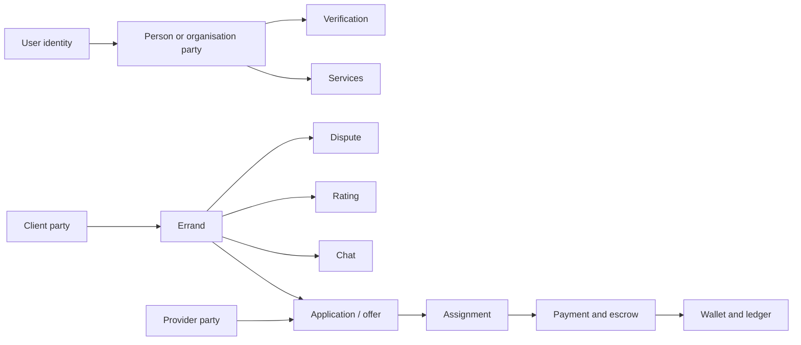

# Errandy Backend

Errandy is a marketplace for getting real-world work done. Clients can publish errands, providers can discover work or receive direct offers, and the platform supports the operational pieces around the transaction: profiles, services, applications, messaging, trust, verification, payments, escrow, wallet activity, ratings, disputes, and notifications.

This repository is the backend service. It exposes a GraphQL API, hosts Better Auth routes, runs the background worker, and owns the domain and persistence model used by the Errandy web and mobile clients.

## Contents

- [What the service does](#what-the-service-does)
- [Architecture](#architecture)
- [Core domains](#core-domains)
- [Technology](#technology)
- [Repository layout](#repository-layout)
- [Getting started](#getting-started)
- [Configuration](#configuration)
- [Running locally](#running-locally)
- [Database and seed data](#database-and-seed-data)
- [API and authentication](#api-and-authentication)
- [Background work and realtime updates](#background-work-and-realtime-updates)
- [Testing and quality](#testing-and-quality)
- [Docker and deployment](#docker-and-deployment)
- [Operational notes](#operational-notes)
- [Troubleshooting](#troubleshooting)

## What the service does

### Marketplace workflow

1. A user signs up with email/password, OTP-capable identity flows, or Google.
2. Better Auth creates the identity; Errandy assigns the user to a supported market and creates the corresponding party/profile workflow.
3. A client creates and publishes an errand with a category, location, budget, service context, and fulfilment requirements.
4. Providers browse open errands, apply, or receive a direct offer.
5. The client accepts an application, assigns work, and the payment/escrow flow records financial state.
6. Participants communicate in chat, complete the work, confirm completion, and can rate or dispute the outcome.

### Implemented product areas

| Area | Responsibilities |
|---|---|
| Identity and users | Better Auth sessions, email/password, Google sign-in, username and phone plugins, market assignment, admin users |
| Party and profiles | Person and organisation parties, client/provider roles, provider tiers, badges, organisation members and public provider profiles |
| Addresses and geography | Saved addresses, defaults, coordinates and geospatial indexes |
| Categories and services | Nigerian market categories, service listings and provider-facing discovery |
| Errands | Drafting, publishing, browsing, direct offers, assignments, cancellation and completion confirmation |
| Applications | Provider applications, direct offers, withdrawal and rejection flows |
| Chat | Threads, messages, history and GraphQL subscriptions for new messages |
| Payments, escrow and wallet | Paystack-oriented payment integration, escrow state, wallet balances, ledger history, bank accounts and withdrawals |
| Trust and safety | Verification profiles, trusted circles, ratings/replies/reactions and disputes |
| Notifications | Market templates and administrative broadcast delivery |

## Architecture

Errandy is a modular NestJS application. Each business module keeps its domain model, application use cases, infrastructure adapters, and GraphQL presentation layer together.

```text
GraphQL resolvers / Better Auth routes
                │
     commands, queries and guards
                │
     domain entities and value objects
                │
 Prisma repositories, Redis, queues and providers
```

The project uses CQRS: commands mutate business state, queries serve read operations, and domain events decouple follow-up work. BullMQ workers handle asynchronous or retryable work; Redis also backs realtime pub/sub where applicable.

Key conventions:

- Domain code does not depend on GraphQL, Prisma, Redis, or third-party SDKs.
- Repositories are accessed through module abstractions and map between domain objects and Prisma records.
- Monetary values are represented in minor units with an explicit currency.
- Market IDs are carried through identity, party, errand, service, and financial workflows.
- Security-sensitive flows use authenticated GraphQL guards and Better Auth’s signed session cookies.

## Core domains



The main modules are `address`, `application`, `category`, `chat`, `dispute`, `errands`, `escrow`, `market`, `notification`, `party`, `payments`, `rating`, `service`, `trusted-circle`, `user`, `verification`, and `wallet`.

For deeper rules and workflow diagrams, see [`docs/`](./docs).

## Technology

| Concern | Technology |
|---|---|
| Runtime | Node.js 22 and TypeScript |
| Framework | NestJS 11 |
| API | GraphQL, Apollo Server and GraphQL subscriptions |
| Authentication | Better Auth, Google OAuth, username, phone and two-factor plugins |
| Database | MongoDB via Prisma |
| Background processing | Redis and BullMQ |
| Payments | Paystack SDK and Errandy payment-provider adapter |
| Email, SMS and push | Resend/Nodemailer, Sendchamp and Firebase Admin |
| Telemetry | OpenTelemetry, Prometheus-compatible metrics and Apollo reporting |
| Deployment | Docker, K3s/Kubernetes, Traefik ingress and Cloudflare |

## Repository layout

```text
src/
  common/                  Shared guards, filters, base classes and contracts
  config/                  GraphQL and runtime configuration
  infrastructure/          Redis, pub/sub, payment and observability adapters
  modules/                 Business modules, grouped by domain
  prisma/                  Prisma NestJS integration
  main.ts                  HTTP, GraphQL, CORS and Better Auth bootstrap
  worker.ts                BullMQ worker bootstrap
prisma/
  model/                   MongoDB Prisma schema
  seed/                    Index, market, category, admin and template seeds
  seed.ts                  Explicit seed entry point
infrastructure/
  k8s/                     K3s/Kubernetes manifests
  terraform/               Azure infrastructure definition
docs/                      Domain and flow documentation
auth.ts                    Better Auth configuration
Dockerfile                 Multi-stage API/worker container build
Makefile                   VM/K3s operational commands
azure-pipelines.yml        Production pipeline definition
```

## Getting started

### Prerequisites

- Node.js 22 or newer
- pnpm (Corepack is recommended)
- A MongoDB deployment configured as a replica set (MongoDB Atlas works well)
- Redis 7 or newer
- Google OAuth credentials if testing social sign-in

### Install

```bash
corepack enable
pnpm install --frozen-lockfile
pnpm prisma
```

`pnpm prisma` only generates the Prisma client. It does not modify a database.

## Configuration

Copy the example file and fill in the values appropriate for your environment:

```bash
cp .env.example .env
```

Important variables:

| Variable | Purpose |
|---|---|
| `DATABASE_URL` | MongoDB connection string |
| `PORT` | API port; defaults to `8080` in deployment manifests |
| `BETTER_AUTH_URL` | Public API origin, for example `https://api.errandy.name.ng` |
| `BETTER_AUTH_SECRET` | Stable secret used to sign Better Auth state and cookies |
| `FRONTEND_URL` | Primary trusted browser origin |
| `GOOGLE_CLIENT_ID`, `GOOGLE_CLIENT_SECRET` | Google OAuth credentials |
| `REDIS_URL` or `REDIS_HOST`, `REDIS_PORT`, `REDIS_PASSWORD` | Redis/BullMQ configuration |
| `PAYSTACK_SECRET_KEY`, `PAYSTACK_PUBLIC_KEY` | Payment provider configuration |
| `RESEND_API` | Transactional email provider key |
| `SENDCHAMP_*` | SMS provider settings |
| `FIREBASE_SERVICE_ACCOUNT_KEY`, `FIREBASE_STORAGE_BUCKET` | Firebase credentials and storage bucket |
| `OTEL_*`, `APOLLO_*` | Optional observability and Apollo reporting configuration |

Never commit `.env`, Firebase service-account JSON, private keys, or production credentials.

## Running locally

Start Redis with Docker Compose:

```bash
docker compose up -d redis
```

Run the API in watch mode:

```bash
pnpm start:dev
```

Run the worker in another terminal when processing queues locally:

```bash
pnpm start:worker
```

Useful commands:

```bash
pnpm build          # compile API and worker
pnpm start:prod     # run compiled API
pnpm prisma         # regenerate Prisma client only
pnpm test           # run Jest tests
pnpm test:e2e       # run end-to-end tests
pnpm lint           # run ESLint with automatic fixes
```

## Database and seed data

The Prisma schema lives in [`prisma/model`](./prisma/model). Collections use explicit Prisma mappings, including `users`, `sessions`, `accounts`, `markets`, `categories`, `errands`, and related marketplace collections.

There are three distinct commands. Use the one that matches your intent:

```bash
pnpm prisma         # generate client; no database write
pnpm prisma:seed    # run seed data only
pnpm prisma:push    # push schema to MongoDB, then run seed data
```

The seed process creates geospatial indexes, the default Nigeria market, service/errand categories, initial admin accounts, and configured notification templates. Because `prisma:push` intentionally seeds after pushing the schema, do not use it casually against shared or production databases.

## API and authentication

### Endpoints

| Endpoint | Purpose |
|---|---|
| `/graphql` | GraphQL queries and mutations |
| `/api/auth/*` | Better Auth routes, including sign-in, sessions, and OAuth callbacks |
| `/health` | Container and load-balancer health check |

The GraphQL schema is code-first. Start the API and use the configured GraphQL explorer in non-production environments to inspect available types, queries, mutations, and subscriptions.

### OAuth and browser origins

Google’s redirect URI must point to the API callback:

```text
https://api.errandy.name.ng/api/auth/callback/google
```

Browser origins must be explicitly listed in both `auth.ts` (`trustedOrigins`) and `src/main.ts` (CORS). Current supported development and production origins include localhost, the deployed dashboard, and the HTTPS local-dashboard setup:

```text
https://dashboard.errandy.name.ng
https://dashboard.errandy.name.ng:3000
```

For local frontend testing against the production API, use HTTPS and `https://dashboard.errandy.name.ng:3000`; this keeps OAuth state cookies same-site with `api.errandy.name.ng`.

## Background work and realtime updates

The worker entry point is [`src/worker.ts`](./src/worker.ts). Run it separately from the HTTP process in production. Redis is required for queue processing and pub/sub-backed features.

Background capabilities include payment/financial continuations, notifications, operational jobs, retries, and dead-letter handling where configured. Chat exposes a GraphQL subscription for new messages.

## Testing and quality

```bash
pnpm test
pnpm test:watch
pnpm test:cov
pnpm test:e2e
pnpm build
```

Before opening a pull request, at minimum run `pnpm prisma` after schema changes and `pnpm build`. Add focused tests for domain rules, commands, and resolver behaviour when changing a feature.

## Docker and deployment

The Docker image is a multi-stage Node 22 Alpine build. It:

1. installs locked pnpm dependencies;
2. generates the Prisma client;
3. compiles both API and worker entry points;
4. ships the compiled output and production dependencies.

The same image runs either entry point:

```bash
node dist/src/main.js    # API
node dist/src/worker.js  # worker
```

Kubernetes manifests are under [`infrastructure/k8s/base`](./infrastructure/k8s/base). The API is served through Traefik for:

```text
api.errandy.name.ng
api.errandy.com.ng
```

The checked-in Azure pipeline triggers only from `main`, archives that exact commit, builds it on the K3s VM, imports the image into K3s, updates secrets, applies manifests, and waits for API and worker rollouts. It does not run a Prisma push or seed command.

For manual operational commands, see the [`Makefile`](./Makefile). Deployment uses `origin/main` as its source; deploy only code that has been merged into `main`.

## Operational notes

- API and worker logs are available through the Kubernetes deployment labels (`app=errandy-api` and `app=errandy-worker`).
- Health checks call `GET /health` on port `8080`.
- Production secrets are Kubernetes secrets populated from the protected environment file and optional Firebase credential file.
- CORS requests use credentials; do not use wildcard origins.
- Keep `BETTER_AUTH_SECRET` stable across deployments or active OAuth state/session cookies will become invalid.
- Pin the deployment to an immutable commit image tag when extending the pipeline; retain `latest` only as a convenience alias for the current K3s manifests.

## Troubleshooting

### Google login returns `state_mismatch`

The state cookie was not available at the OAuth callback. Check that the frontend uses a trusted origin, cookies are enabled, and local production-API testing uses the HTTPS same-site dashboard hostname rather than plain `localhost`.

### Browser reports a CORS error for `/api/auth/*`

Add the exact origin, including its scheme and port, to both CORS configuration in `src/main.ts` and Better Auth `trustedOrigins` in `auth.ts`. Redeploy the API after the change.

### Prisma says a field is unknown or missing

Regenerate the client after pulling schema changes:

```bash
pnpm prisma
```

Do not run `pnpm prisma:push` unless you explicitly intend to update the connected database.

### Docker build fails during `pnpm build`

Run `pnpm prisma` locally, then `pnpm build`. Prisma model changes must be reflected in seed code, mappers, and any typed create/update inputs.

### The new backend build is not deployed

Production deployment is sourced from `main`. Merge the desired commit into `main`, let the pipeline complete (or run the approved deployment flow), then verify the Kubernetes rollout.

## Contributing

Keep changes small and module-focused. Preserve the domain/application/infrastructure/presentation separation, update the relevant documentation for workflow changes, and never add credentials or generated local files to Git.

## License

Private and unlicensed. All rights reserved.
